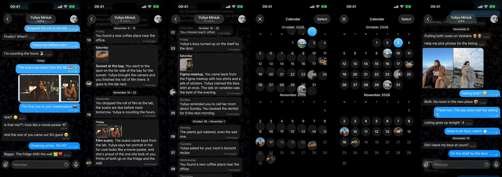

# Timeline Zoom

Pinch out in a chat: each day's messages flow together into one message saying what the day was about. Pinch out again and the days fly into Telegram's own calendar. Tap your way back down to the exact message.

**Demo video:** [`media/demo.mp4`](media/demo.mp4)

## Why

You remember *what* you talked about, not *when*. Today the way back is a long scroll, or a tap on a date pill that
opens the calendar sheet. The calendar knows dates and media, but not what a day was about. Search only works if you
remember the exact word.

## What it does

1. **Pinch out in a chat.** The chat turns into a group chat of its own days: every day is one incoming message, with
   the day's number as the avatar, the weekday as the sender and a summary as the text. *Boat trip. You left from Pier 3
   at 10 with the sandwiches Yuliya packed. Dolphins swam right up to the boat…* The day's bubbles flow together into
   that one bubble like a liquid, and its date pill rounds up into the avatar. Weeks sit under date pills.
2. **Photos stay visible.** A day with photos shows them as a strip in its bubble, and its avatar is the first photo,
   the way Telegram's calendar already marks a day with media.
3. **Days that stand out, stand out.** A trip, a birthday or a move gets a bold lead and a colored avatar; ordinary days
   stay quiet, so the eye lands on what you are likely looking for.
4. **Pinch out again.** Each bubble folds into its avatar, and the avatars fly to their days in Telegram's calendar
   sheet, which brings its own navigation bar (close, "Calendar", "Select"). Photo days keep their thumbnail there,
   notable days their color.
5. **Tap a calendar day** and you're in the chat at that day: the circle opens into the day's row (a beat to read what
   it was about), the row into its messages. **Tap a day** at the days level to land on its first message. Telegram's
   round "scroll to the latest" button takes you back down.
6. **Without the pinch.** At the days level the week you are scrolling through sticks under the header on glass, like
   the chat's floating date. Tapping a week's pill opens the calendar, the way a date pill does in a chat.
7. Pinch in at any level to go back. The day under your fingers stays where it is.

Nothing here is invented UI: the message bubble, the avatar, the sender name, the date pill and the calendar are
Telegram's own, with their sizes taken from the source. The concept only adds the summaries and the motion between them.

## Edge cases

- **Day and night themes**: bubbles use the incoming message colors of each theme, quiet avatars use the service
  background (the date pill material), and the calendar uses the list colors.
- **Days without messages** are skipped in the days level and look as usual in the calendar.
- **No summary yet**, for example while it's still being generated: the bubble shows the day's first message.
- **Short chats**: content shorter than the screen sits at the bottom, like the chat itself.
- **Not covered by the demo:** albums and video, reduced motion (would crossfade between levels), groups (summaries
  per topic or thread), RTL, and paging long histories (the calendar sheet already loads by month).

## How it works

| Piece | Where |
| --- | --- |
| The zoom: one `zoom` value (0 = chat, 1 = days, 2 = calendar) drives every frame; a pinch or a spring moves it | `Feature/TimelineView.swift` |
| The liquid: rounded rects merged by a smooth minimum of their distance fields, with their colors blended | `Feature/Goo.metal`, `Feature/GooView.swift` |
| The day bubble, the colored avatar, the calendar, the spring | `Feature/TimelineParts.swift` |
| Hooking into the chat: the pinch, layering under the messages | `Feature/TimelineZoomFeature.swift` |
| Hands-free demo playback, driven frame by frame, with drawn fingers | `Feature/TimelineZoomFeature.swift`, `Feature/ScenarioFingers.swift` |
| 100 days of demo history with precomputed summaries | `App/History.swift` |
| Demo photos (Unsplash, credits inside) | `App/Photos/` |
| Telegram's chat screen, rebuilt in plain UIKit for the demo | `Vendor/TelegramShell` |

**Summaries.** The demo ships them precomputed. In Telegram they could come from an on-device model (Apple's Foundation
Models on iOS 26) running over a day's text once the day is over, and be cached per chat. Nothing leaves the device.
Each summary carries a salience score, which decides whether the day stands out.

**Where it goes in Telegram-iOS.**

- `ChatHistoryListNode`: the pinch, and the anchor message, which is the day under the fingers.
- `ChatMessageBubbleItemNode`, `ChatMessageAvatarHeader`, `ChatMessageDateHeader`: the bubble, the avatar and the pill
  the days level is made of.
- `CalendarMessageScreen`: the top level, in place of the sheet (`ChatControllerOpenCalendarSearch.swift` opens it today).
- `SparseMessageList`: per-day message counts, already used by the calendar.

## Run

Open `TimelineZoom.xcodeproj`, pick an iPhone simulator and Run. No dependencies; UIKit, iOS 26+.
Launch with `-scenario` to play the demo hands-free: Yuliya's reply comes in, a little scroll up, out to the days, up
to the Figma meetup, out to the calendar, into the fur coats' day and back down to the latest. Add `-touches` to see
the fingers (`xcrun simctl launch booted concept.timeline-zoom -scenario -touches`). The demo runs in the dark theme;
launch with `-light` to follow the system appearance.

---

The chat screen is transcribed from [Telegram-iOS](https://github.com/TelegramMessenger/Telegram-iOS) (GPL-2.0). This is a UX prototype, not a client.

